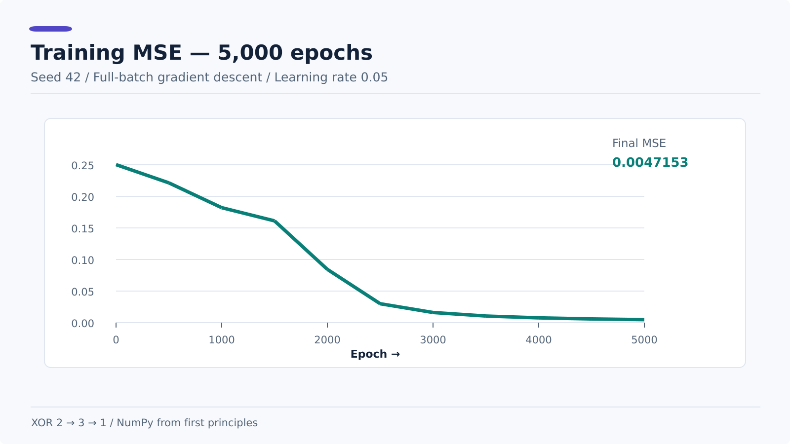

# Neural-Network

This repo is where I keep my work on neural networks, from the first neuron to a trainable XOR network.

I started with forward propagation, then moved through loss functions, derivatives, the chain rule, and backpropagation. The final XOR network uses NumPy for the matrix operations. No PyTorch or TensorFlow in the training code.

The notes follow the order I learned things. The examples are small on purpose, so each part can be run and checked separately.

## Start here

Depends on what you're looking for:

| Want to... | Open |
| --- | --- |
| Run the full XOR network | [`examples/xor_network.py`](examples/xor_network.py) |
| Understand the XOR architecture | [Lesson 11](notes/11-xor-problem-and-architecture.md) |
| Follow the complete XOR maths | [Lessons 11 to 16](#xor-network-lessons-11-16) |
| Start with basic neural networks | [Lesson 01](notes/01-fundamentals.md) |
| Look up a derivative or matrix shape | [`CHEATSHEET.md`](CHEATSHEET.md) |
| Find the diagrams | [XOR diagram index](assets/xor/README.md) |
| Read the full article | [Medium article](https://medium.com/@devvaibhav37/building-a-neural-network-from-scratch-the-mathematics-behind-learning-xor-10441e674a69) |

## XOR network

The network has 2 inputs, 3 hidden neurons with ReLU, and 1 sigmoid output.


The training loop in [`examples/xor_network.py`](examples/xor_network.py) covers:

* Forward pass using matrix multiplication
* Mean squared error (MSE)
* Output layer gradients
* Hidden layer gradients through ReLU
* Updates to all weights and biases with batch gradient descent

There are 13 trainable parameters. I used random seed `42`, learning rate `0.05`, and 5,000 epochs.

### Run it

Python 3.10+ and NumPy are enough.

```bash
python -m pip install -r requirements.txt
python examples/xor_network.py
```

The script prints the loss every 500 epochs, then the final outputs and MSE.

### Results

| Input | Target | Output | Predicted |
| --- | ---: | ---: | ---: |
| (0, 0) | 0 | 0.0839 | 0 |
| (0, 1) | 1 | 0.9505 | 1 |
| (1, 0) | 1 | 0.9517 | 1 |
| (1, 1) | 0 | 0.0839 | 0 |

Final MSE: **0.004715**  
Correct predictions: **4/4**



All four combinations are part of the training data. This shows the network learned this XOR dataset; it isn't a test on unseen data. I haven't added numerical gradient checking yet.

## Notes

There are 16 lessons. The first 10 build up the maths and smaller examples. The last 6 cover the actual XOR network.

### Fundamentals and training: Lessons 01 to 08

| Lesson | What's inside |
| --- | --- |
| [01: Fundamentals](notes/01-fundamentals.md) | Inputs, neurons, weights, biases, layers |
| [02: Training and loss](notes/02-training-and-loss.md) | Predictions, errors, loss, why weights change |
| [03: Activation functions](notes/03-activation-functions.md) | ReLU, sigmoid, why nonlinearity matters |
| [04: Hidden-layer forward pass](notes/04-hidden-layer-forward-pass.md) | Weighted sums, matrix shapes, forward calculations |
| [05: Loss and gradients](notes/05-linear-regression-loss-and-gradients.md) | MSE, partial derivatives, first gradients |
| [06: First training loop](notes/06-first-gradient-descent-training-loop.md) | Train one neuron with plain Python |
| [07: Batch gradient descent](notes/07-vectorized-batch-gradient-descent.md) | NumPy vectorization and updating from multiple examples |
| [08: ReLU derivative](notes/08-relu-derivative-and-chain-rule-intro.md) | Derivative masks and the first chain-rule step |

### Backpropagation: Lessons 09 to 10

| Lesson | What's inside |
| --- | --- |
| [09: Chain rule and gradients](notes/09-chain-rule-and-backpropagation-gradients.md) | Trace the loss back to a neuron's weight and bias |
| [10: Output-layer backpropagation](notes/10-output-layer-forward-backprop-and-update.md) | A 2 → 3 → 1 forward pass and one output layer update |

Lesson 10 only updates the output layer. The hidden layer gradients come later, in lesson 14.

### XOR network: Lessons 11 to 16

| Lesson | What's inside |
| --- | --- |
| [11: XOR and architecture](notes/11-xor-problem-and-architecture.md) | Truth table, network structure, 13 parameters |
| [12: Forward pass and MSE](notes/12-xor-vectorized-forward-and-loss.md) | Batch predictions, activations, loss |
| [13: Output-layer backprop](notes/13-xor-output-layer-backprop.md) | Sigmoid derivative, output weight and bias gradients |
| [14: Hidden-layer backprop](notes/14-xor-hidden-layer-backprop.md) | Gradient flow through output weights and ReLU |
| [15: Training loop](notes/15-xor-gradient-descent-and-epochs.md) | Parameter updates and the 5,000-epoch loop |
| [16: Initialization and results](notes/16-xor-random-initialization-and-results.md) | Seeded weights, loss trace, final predictions |

If you're mainly here for backpropagation, start at lesson 09 and work forward. Each step uses the equations introduced before it.

## Python examples

These match the notes. You can run any one of them from the repo root.

| File | What it does |
| --- | --- |
| [`neuron.py`](examples/neuron.py) | One neuron's forward pass in plain Python |
| [`loss.py`](examples/loss.py) | Squared error for a few predictions |
| [`hidden_layer_numpy.py`](examples/hidden_layer_numpy.py) | Dense layer forward pass with NumPy |
| [`linear_regression_and_mse.py`](examples/linear_regression_and_mse.py) | Linear predictions and MSE, without training |
| [`train_single_neuron.py`](examples/train_single_neuron.py) | First weight and bias updates |
| [`train_batch_neuron_numpy.py`](examples/train_batch_neuron_numpy.py) | Train one neuron on four examples |
| [`relu_derivative_numpy.py`](examples/relu_derivative_numpy.py) | ReLU derivative using a NumPy mask |
| [`output_layer_single_step.py`](examples/output_layer_single_step.py) | One output layer backpropagation update |
| [`xor_network.py`](examples/xor_network.py) | Full XOR training with hidden layer backpropagation |

If you're starting from the basics, run these in order:

```bash
python examples/neuron.py
python examples/train_single_neuron.py
python examples/train_batch_neuron_numpy.py
python examples/output_layer_single_step.py
python examples/xor_network.py
```

The first script only calculates an output. The next two show weight updates with one example and then a batch. The fourth works through an output layer update. The XOR script trains both layers.

## Diagrams

I kept the diagrams alongside the notes so the matrix shapes and gradient paths are easier to follow.

The [XOR diagram index](assets/xor/README.md) has all 12 diagrams, including the architecture, forward pass, chain rule, hidden layer gradients, loss curve, and final predictions. SVG and PNG exports are there, along with editable Excalidraw sources.

There are also earlier diagrams in [`assets/`](assets/) for the single neuron and output layer lessons.

## Other links

* [Neural network cheat sheet](CHEATSHEET.md): equations and NumPy shapes without the full derivations
* [ML-MATH](https://github.com/Vaibh37/ML-MATH): related mathematics notes
* [Medium: Building a Neural Network From Scratch: The Mathematics Behind Learning XOR](https://medium.com/@devvaibhav37/building-a-neural-network-from-scratch-the-mathematics-behind-learning-xor-10441e674a69): full article about the XOR build
