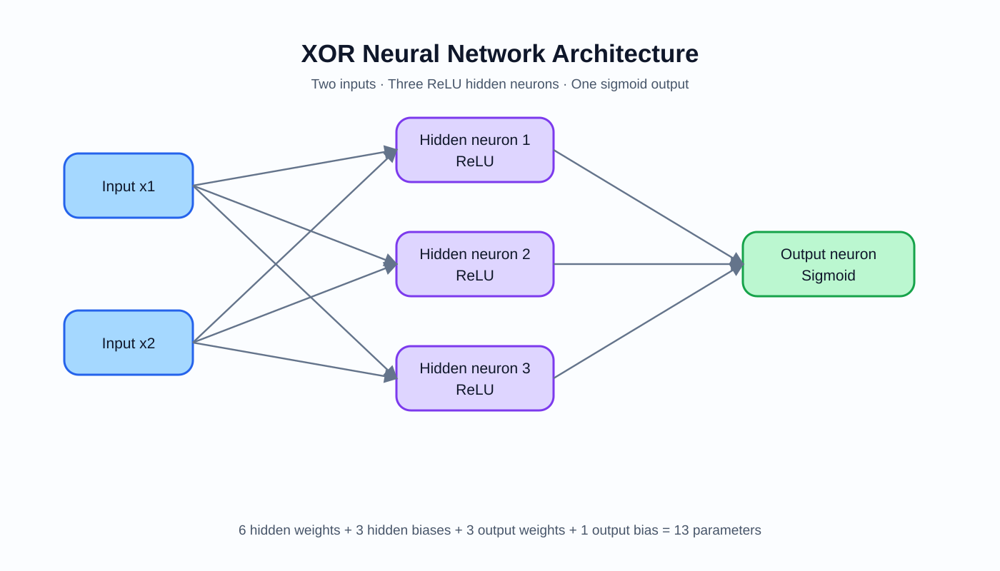
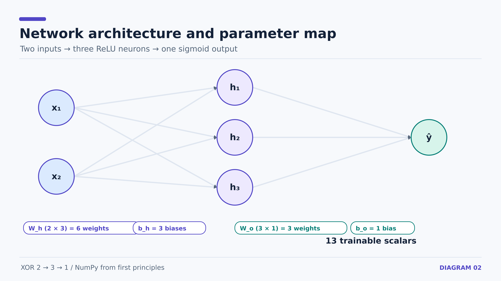
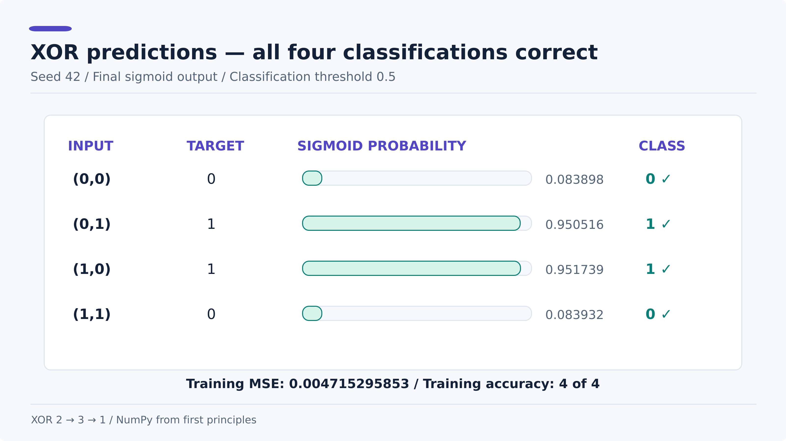

# Neural-Network

Personal notes and runnable Python examples for learning neural network fundamentals from first principles.

**Start here:** [Run the XOR network](examples/xor_network.py) · [Read the step-by-step math](notes/11-xor-problem-and-architecture.md) · [Explore 12 editable diagrams](assets/xor/README.md) · [Companion ML-MATH repository](https://github.com/Vaibh37/ML-MATH)

**Medium article:** [Building a Neural Network From Scratch: The Mathematics Behind Learning XOR](https://medium.com/@devvaibhav37/building-a-neural-network-from-scratch-the-mathematics-behind-learning-xor-10441e674a69)

If this project helps you understand neural networks, consider **starring the repository**. Feedback, questions, and suggestions are welcome through [GitHub Issues](https://github.com/Vaibh37/Neural-Network/issues).

## XOR neural network from scratch — 18 October 2026

A fully trainable **2 → 3 → 1** neural network built in **Python + NumPy**, with no deep-learning framework.



The implementation uses **ReLU** in the hidden layer, **sigmoid** for the output, **mean squared error**, manually derived **backpropagation**, and **full-batch gradient descent**. It trains on the four XOR combinations for 5,000 epochs using learning rate **0.05** and reproducible random initialization (seed **42**).

**Run the implementation:**

```bash
python -m pip install -r requirements.txt
python examples/xor_network.py
```

| Input | Target | Model probability | Predicted class |
| --- | ---: | ---: | ---: |
| (0, 0) | 0 | 0.08389788 | 0 |
| (0, 1) | 1 | 0.95051648 | 1 |
| (1, 0) | 1 | 0.95173893 | 1 |
| (1, 1) | 0 | 0.08393200 | 0 |

**Final training MSE:** `0.00471529585312808` · **Accuracy on the four XOR training cases:** `4/4`.

**Illustrated lesson collection:** [12 diagrams with high-resolution PNG, scalable SVG, and editable Excalidraw files](assets/xor/README.md).

| The network | Training | Final XOR predictions |
| --- | --- | --- |
|  |  |  |

For the step-by-step mathematics, follow the new sequence: [Lesson 11](notes/11-xor-problem-and-architecture.md) → [12](notes/12-xor-vectorized-forward-and-loss.md) → [13](notes/13-xor-output-layer-backprop.md) → [14](notes/14-xor-hidden-layer-backprop.md) → [15](notes/15-xor-gradient-descent-and-epochs.md) → [16](notes/16-xor-random-initialization-and-results.md).

The earlier architecture, forward-pass, and backpropagation diagrams have also been retained for historical reference.

This is a small educational demonstration, not a benchmark of generalization. The implementation has been tested on XOR, but complete numerical checking of all parameter gradients is deferred.

## Topics covered

- Inputs, outputs, pixels, and input neurons
- Hidden neurons, weights, weighted sums, and biases
- Activation functions, including ReLU and sigmoid
- Layers, connections, and forward calculations
- Training at a high level: predictions, error, and loss
- Squared error and the goal of minimizing loss

## Learning material

| Path | Content |
| --- | --- |
| [notes/01-fundamentals.md](notes/01-fundamentals.md) | Neurons, layers, weights, biases, sigmoid, and a complete forward-pass example |
| [notes/02-training-and-loss.md](notes/02-training-and-loss.md) | How training works conceptually, squared error, and loss minimization |
| [notes/03-activation-functions.md](notes/03-activation-functions.md) | Why activations matter; worked ReLU and sigmoid examples |
| [notes/04-hidden-layer-forward-pass.md](notes/04-hidden-layer-forward-pass.md) | Detailed 2-neuron and 3-neuron forward passes, dimensions and diagrams |
| [notes/05-linear-regression-loss-and-gradients.md](notes/05-linear-regression-loss-and-gradients.md) | Practiced NumPy MSE, linear prediction, derivative notation and single-sample loss gradients |
| [notes/06-first-gradient-descent-training-loop.md](notes/06-first-gradient-descent-training-loop.md) | Single-sample gradient descent, first five epochs, and per-epoch updates |
| [notes/07-vectorized-batch-gradient-descent.md](notes/07-vectorized-batch-gradient-descent.md) | Four-example NumPy gradients, full-batch training, five-epoch loss trace and common mistakes |
| [notes/08-relu-derivative-and-chain-rule-intro.md](notes/08-relu-derivative-and-chain-rule-intro.md) | ReLU derivative, Boolean masks, and first chain-rule step through an activation |
| [notes/09-chain-rule-and-backpropagation-gradients.md](notes/09-chain-rule-and-backpropagation-gradients.md) | Chain rule derived twice, weight and bias gradients, worked neuron example and four linked diagrams |
| [notes/10-output-layer-forward-backprop-and-update.md](notes/10-output-layer-forward-backprop-and-update.md) | 2→3→1 forward pass, separate output weights, four gradient derivations, output-bias derivative and gradient descent with diagrams |
| [examples/output_layer_single_step.py](examples/output_layer_single_step.py) | Runnable NumPy one-example output-layer gradient and update checks |
| [examples/xor_network.py](examples/xor_network.py) | Full 2→3→1 XOR network with manual backpropagation, 5000 epochs, and final classification |
| [notes/11-xor-problem-and-architecture.md](notes/11-xor-problem-and-architecture.md) | XOR truth table, nonlinearity, and all 13 trainable parameters |
| [notes/12-xor-vectorized-forward-and-loss.md](notes/12-xor-vectorized-forward-and-loss.md) | Matrix shapes, ReLU, sigmoid, and batch MSE |
| [notes/13-xor-output-layer-backprop.md](notes/13-xor-output-layer-backprop.md) | Output sigmoid derivative, chain rule, and output weight/bias gradients |
| [notes/14-xor-hidden-layer-backprop.md](notes/14-xor-hidden-layer-backprop.md) | Hidden ReLU mask, gradients through W_o.T, and hidden parameters |
| [notes/15-xor-gradient-descent-and-epochs.md](notes/15-xor-gradient-descent-and-epochs.md) | Correct update order, recalculating predictions, and the epoch loop |
| [notes/16-xor-random-initialization-and-results.md](notes/16-xor-random-initialization-and-results.md) | Seeded random initialization, exact 5000-epoch results, and limitations |
| [assets/xor/README.md](assets/xor/README.md) | Indexed gallery of 12 editable Excalidraw diagrams with 3200px PNG and SVG exports |
| [assets/lesson-10-output-layer](assets/lesson-10-output-layer) | Five vector diagrams with automated 3200px PNG exports |
| [examples/train_batch_neuron_numpy.py](examples/train_batch_neuron_numpy.py) | Executable 4-example training loop with numeric checks |
| [examples/relu_derivative_numpy.py](examples/relu_derivative_numpy.py) | Executable ReLU derivative with NumPy |
| [examples/linear_regression_and_mse.py](examples/linear_regression_and_mse.py) | Reproducible prediction and MSE checks; no parameter training |
| [CHEATSHEET.md](CHEATSHEET.md) | Fast formula and terminology reference |
| [examples/hidden_layer_numpy.py](examples/hidden_layer_numpy.py) | Executable NumPy forward pass with assertions |
| [assets/hidden-layer-forward-pass.svg](assets/hidden-layer-forward-pass.svg) | Scalable diagram of calculations inside a hidden layer |
| [assets/hidden-layer-forward-pass.png](assets/hidden-layer-forward-pass.png) | PNG export of the forward-pass diagram |
| [examples/neuron.py](examples/neuron.py) | Pure Python weighted sum, bias, and sigmoid |
| [examples/loss.py](examples/loss.py) | Pure Python loss calculations |

Use Python 3.10+ and install the only third-party dependency before running the examples:

~~~bash
python -m pip install -r requirements.txt
~~~

Then run:

```bash
python examples/neuron.py
python examples/loss.py
python examples/hidden_layer_numpy.py
python examples/linear_regression_and_mse.py
python examples/train_single_neuron.py
python examples/train_batch_neuron_numpy.py
python examples/relu_derivative_numpy.py
python examples/output_layer_single_step.py
python examples/xor_network.py
```

## Source

[3Blue1Brown — But what is a neural network? (Deep learning chapter 1)](https://youtu.be/aircAruvnKk)

## Current status

**18 October 2026:** The full 2 → 3 → 1 XOR network has been implemented, trained, and evaluated in NumPy. All four XOR training cases classify correctly. Weights use seeded random initialization. The loss starts near 0.25 and reaches **0.0047153** after 5,000 updates. See [the XOR implementation](examples/xor_network.py) and [architecture diagram](assets/xor/01-architecture.svg).

**Historical learning checkpoints:** Earlier notes capture incremental work on single-neuron training, vectorized MSE, ReLU derivatives, the chain rule, and output-layer backpropagation. See [lesson 07](notes/07-vectorized-batch-gradient-descent.md), [lesson 08](notes/08-relu-derivative-and-chain-rule-intro.md), [lesson 09](notes/09-chain-rule-and-backpropagation-gradients.md), and [lesson 10](notes/10-output-layer-forward-backprop-and-update.md).

**Next:** Publish a technical write-up. Numerical gradient checking is postponed for a separate follow-up.
