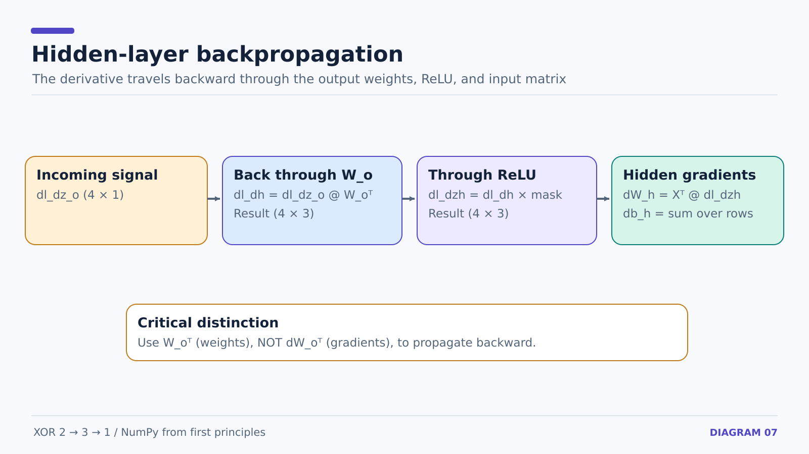

# XOR neural network — illustrated lesson assets

These are teaching diagrams for the actual NumPy XOR network in [`examples/xor_network.py`](../../examples/xor_network.py). They are intended to be **edited and reused in notes**, not treated as screenshots from a framework.

**Formats:** Editable [Excalidraw](https://excalidraw.com/) source (`.excalidraw`), scalable SVG (`.svg`), and auto-generated high-resolution **3,200-pixel-wide PNG** (`.png`).

The original diagram source is preserved so future changes to explanations and annotations are possible.

| # | Diagram | Lesson | Edit | Preview | PNG |
| --- | --- | --- | --- | --- | --- |
| 01 | XOR truth table and nonlinear separability | [11](../../notes/11-xor-problem-and-architecture.md) | [Excalidraw](d01-xor-dataset.excalidraw) | [SVG](d01-xor-dataset.svg) | [PNG](d01-xor-dataset.png) |
| 02 | 2→3→1 architecture, weights, and biases | [11](../../notes/11-xor-problem-and-architecture.md) | [Excalidraw](d02-parameter-map.excalidraw) | [SVG](d02-parameter-map.svg) | [PNG](d02-parameter-map.png) |
| 03 | Batch tensor dimensions and matrix products | [12](../../notes/12-xor-vectorized-forward-and-loss.md) | [Excalidraw](d03-tensor-shapes.excalidraw) | [SVG](d03-tensor-shapes.svg) | [PNG](d03-tensor-shapes.png) |
| 04 | Forward pass from X through sigmoid and MSE | [12](../../notes/12-xor-vectorized-forward-and-loss.md) | [Excalidraw](d04-forward-flow.excalidraw) | [SVG](d04-forward-flow.svg) | [PNG](d04-forward-flow.png) |
| 05 | MSE → sigmoid derivative → dL/dZ_o | [13](../../notes/13-xor-output-layer-backprop.md) | [Excalidraw](d05-output-chain-rule.excalidraw) | [SVG](d05-output-chain-rule.svg) | [PNG](d05-output-chain-rule.png) |
| 06 | Output weight/bias gradient shapes | [13](../../notes/13-xor-output-layer-backprop.md) | [Excalidraw](d06-output-parameter-gradients.excalidraw) | [SVG](d06-output-parameter-gradients.svg) | [PNG](d06-output-parameter-gradients.png) |
| 07 | Backpropagate through W_o and ReLU | [14](../../notes/14-xor-hidden-layer-backprop.md) | [Excalidraw](d07-hidden-backprop-path.excalidraw) | [SVG](d07-hidden-backprop-path.svg) | [PNG](d07-hidden-backprop-path.png) |
| 08 | ReLU derivative for actual seed-42 inputs | [14](../../notes/14-xor-hidden-layer-backprop.md) | [Excalidraw](d08-relu-gradient-mask.excalidraw) | [SVG](d08-relu-gradient-mask.svg) | [PNG](d08-relu-gradient-mask.png) |
| 09 | Forward → loss → backward → update cycle | [15](../../notes/15-xor-gradient-descent-and-epochs.md) | [Excalidraw](d09-training-loop.excalidraw) | [SVG](d09-training-loop.svg) | [PNG](d09-training-loop.png) |
| 10 | Seeded weights and zero biases | [16](../../notes/16-xor-random-initialization-and-results.md) | [Excalidraw](d10-random-initialization.excalidraw) | [SVG](d10-random-initialization.svg) | [PNG](d10-random-initialization.png) |
| 11 | Recorded MSE from 0 to 5,000 epochs | [16](../../notes/16-xor-random-initialization-and-results.md) | [Excalidraw](d11-loss-curve.excalidraw) | [SVG](d11-loss-curve.svg) | [PNG](d11-loss-curve.png) |
| 12 | All four XOR probabilities and classifications | [16](../../notes/16-xor-random-initialization-and-results.md) | [Excalidraw](d12-final-predictions.excalidraw) | [SVG](d12-final-predictions.svg) | [PNG](d12-final-predictions.png) |

## Selected previews

### Architecture and parameter counts


### Hidden-layer backpropagation



### Training loss


### Predictions


## Reproducibility

The PNGs are rendered directly from their matching SVG sources by [the GitHub Actions workflow](../../.github/workflows/render-xor-diagrams.yml). To regenerate them locally on Linux with `librsvg` installed:

```bash
for svg in assets/xor/d*.svg; do
  rsvg-convert --keep-aspect-ratio --width 3200 \
    --output "${svg%.svg}.png" "$svg"
done
```

The architecture and equations are based on the project's actual **2 inputs → 3 ReLU hidden neurons → 1 sigmoid output** implementation. The graph uses training errors measured with seed 42, learning rate 0.05, and 5,000 full-batch updates. The evaluation uses the four training examples, not a held-out dataset.
