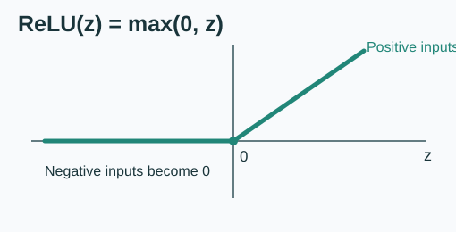

# 03 — Activation Functions: Why, ReLU and Sigmoid

**Studied:** 15 October 2026. **Prerequisite:** compute weighted sums and add a bias.

## 1. Why activations are needed

A dense neuron computes z = w · x + b. A whole dense layer computes Z = WX + b. These are **affine** calculations. Stacking only affine transformations produces another affine transformation: the extra layers do not add nonlinearity.

An activation function transforms z, typically nonlinearly. The complete activated layer is:

$$
Z=WX+b,\qquad A=f(Z).
$$

Different activations produce different results for the same Z.

## 2. ReLU

**Rectified Linear Unit:**

$$
\operatorname{ReLU}(z)=\max(0,z).
$$

The max function picks the **larger** number: max(0,-3)=0, max(0,5)=5.

$$
\operatorname{ReLU}\begin{pmatrix}-3\\5\\-2\end{pmatrix}
=
\begin{pmatrix}0\\5\\0\end{pmatrix}.
$$

Negative inputs become 0. Zero stays 0. Positive inputs remain unchanged. ReLU is common in hidden layers, although other functions are also used.

## 3. Sigmoid

$$
\sigma(z)=\frac{1}{1+e^{-z}}.
$$

The output lies **strictly between 0 and 1** for finite real z:

| z | sigmoid(z) |
|---:|---:|
| -5 | about 0.0067 |
| 0 | exactly 0.5 |
| 3 | about 0.9526 |
| 10 | about 0.99995 |

Why is sigmoid(0)=0.5? Because e⁰=1, so 1/(1+1) = 1/2.

Sigmoid is often useful as a **binary-classification output activation**. That does not make every sigmoid value automatically well-calibrated as a real-world probability.

## 4. Same input, different functions

For z=3:
- ReLU(3) = 3.
- Sigmoid(3) ≈ 0.9526.

## 5. Python

~~~python
import math
import numpy as np

def relu(z):
    return np.maximum(0, z)

def sigmoid(z):
    return 1 / (1 + np.exp(-z))

z = np.array([[-3], [5], [-2]])
print(relu(z))           # [[0], [5], [0]]
print(sigmoid(np.array([[0.0]])))  # [[0.5]]
~~~

This implementation demonstrates numerical behavior, not parameter learning. Other activations, such as tanh and GELU, can be studied later.

**Quick check:** Which function returns exactly 0 for z=-8? ReLU. Which gives 0.5 for z=0? Sigmoid.
