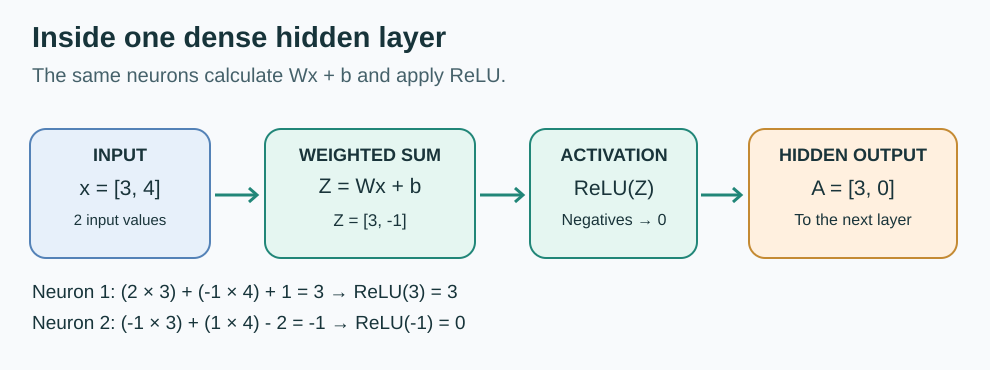

# 04 — Hidden-Layer Forward Propagation

**Status:** Practiced and solved independently on 15 October 2026. This note teaches the **forward pass**, not training.

## What happens inside a hidden layer?

Each dense neuron receives the preceding layer's input, performs a **weighted sum**, adds its **own bias**, and applies an **activation** such as ReLU.

For one neuron: $z_i=w_i\cdot x+b_i$, then $a_i=\operatorname{ReLU}(z_i)$.

For the complete dense layer:

$$
Z=Wx+b,\qquad A=\operatorname{ReLU}(Z).
$$

The multiplication, bias addition, and activation are *operations* of the layer. They are **not three separate layers of neurons**. Some programming frameworks represent the linear transform and activation as separate modules, which is a code-organization detail.

[PNG export of this diagram](../assets/hidden-layer-forward-pass.png) · [Editable SVG](../assets/hidden-layer-forward-pass.svg)

## Worked example: two inputs and two hidden neurons

$$
x=\begin{bmatrix}3\\4\end{bmatrix},
\quad
W=\begin{bmatrix}2&-1\\-1&1\end{bmatrix},
\quad
b=\begin{bmatrix}1\\-2\end{bmatrix}.
$$

**Neuron 1** uses row 1 of W and bias 1:

$$
z_1=(2\times3)+(-1\times4)+1=6-4+1=3.
$$

**Neuron 2** uses row 2 of W and bias -2:

$$
z_2=(-1\times3)+(1\times4)-2=-3+4-2=-1.
$$

Combine their pre-activation values:

$$
Z=\begin{bmatrix}3\\-1\end{bmatrix}.
$$

Apply ReLU elementwise:

$$
A=\begin{bmatrix}\max(0,3)\\\max(0,-1)\end{bmatrix}
=\begin{bmatrix}3\\0\end{bmatrix}.
$$

Both values in A become the **input values for the next layer**, assuming another layer follows.

## Independent final challenge: three hidden neurons

$$
x=\begin{bmatrix}2\\-1\end{bmatrix},\quad
W=\begin{bmatrix}2&1\\-1&3\\1&-2\end{bmatrix},\quad
b=\begin{bmatrix}1\\2\\-3\end{bmatrix}.
$$

Work out all three weighted sums:

- Neuron 1: (2 × 2) + (1 × -1) + 1 = **4**.
- Neuron 2: (-1 × 2) + (3 × -1) + 2 = **-3**.
- Neuron 3: (1 × 2) + (-2 × -1) - 3 = **1**.

$$
Z=\begin{bmatrix}4\\-3\\1\end{bmatrix},
\quad
A=\operatorname{ReLU}(Z)=\begin{bmatrix}4\\0\\1\end{bmatrix}.
$$

**Dimensions:** W:(3,2), x:(2,1), b:(3,1), Z:(3,1), A:(3,1). ReLU does **not** change the shape.

## Several input samples: X as a matrix

With s samples stored as **columns**, X:(2,s). Then WX:(3,s), and b:(3,1) broadcasts across s columns; the result is A:(3,s).

For example, X:(2,4) means 4 samples and produces A:(3,4), not A:(3,1). This is why bias is conceptually reused across the four columns.

**Important NumPy shape detail:** x = np.array([2,-1]) has shape (2,), not (2,1). Use np.array([[2],[-1]]) for a literal column vector.

Many popular libraries use the **samples-as-rows** convention instead. They compute XWᵀ + bᵀ with corresponding shapes. Both conventions are valid when applied consistently.

## Run the result

~~~bash
python -m pip install numpy
python examples/hidden_layer_numpy.py
~~~

The code checks the worked 2-neuron and 3-neuron examples and reports the exact shapes.

## Common questions

**Is Wx+b a separate hidden layer?** No. It is the linear/affine computation inside a dense layer. ReLU follows it.

**Is Wx a vector?** If x is a single column vector, yes, the result is another column vector. If X contains many input columns, WX is a matrix.

**Does broadcasting always duplicate values?** It behaves as if a dimension of length 1 expands. NumPy need not physically copy the values.

**Have we trained a network?** No. The weights and biases here were chosen manually. Training will require a loss function and parameter updates.
