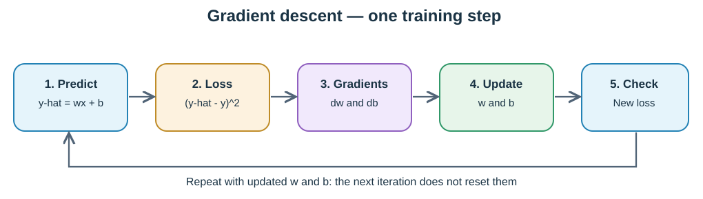

# 06 — First Gradient Descent Training Loop (16 October 2026)

**Status:** Built and checked a **single-example linear-neuron training loop in Python**. This is not the planned 2→3→1 XOR network, and it does not use NumPy arrays yet.

## 1. The exact question we are solving

Given input x = 2, target y = 10, weight w = 3, bias b = 1, and learning rate 0.05, can repeated updates make the prediction approach 10?

Prediction: **y-hat = w × x + b**. At the start, it equals 7.

Loss: **L = (y-hat − y)²**. At the start, it equals 9.

**Important:** Target 10 and loss 9 are NOT the same kind of quantity. We want prediction to approach 10 while the loss approaches **zero**.

## 2. The five operations of one update

1. **Forward pass:** calculate pred_y = w * x + b.
2. **Loss:** calculate (pred_y − y)².
3. **Gradients:** use chain-rule derivatives of loss with respect to weight and bias.
4. **Gradient descent:** change w and b using the learning rate.
5. **Check result:** predict again and calculate loss with updated parameters.

The first two values measure *where we are*. Gradients tell us *how changing parameters affects loss*. Updates change the model.

## 3. Where the gradient formulas come from

~~~math
\begin{aligned}
L(w,b)&=(wx+b-y)^2,\\
\frac{\partial L}{\partial w}&=2(wx+b-y)x=2(\hat y-y)x,\\
\frac{\partial L}{\partial b}&=2(wx+b-y)=2(\hat y-y).
\end{aligned}
~~~

When differentiating with respect to **w**, x is a constant multiplier, so the derivative of wx is **x**. When differentiating with respect to **b**, the inside derivative is **1**.

With prediction 7 and target 10: dw = −12 and db = −6.

Use **learning_rate = 0.05** (chosen hyperparameter):

- New w = 3 − 0.05 × (−12) = **3.6**.
- New b = 1 − 0.05 × (−6) = **1.3**.
- Updated prediction = 3.6 × 2 + 1.3 = **8.5**.
- Updated loss = (8.5 − 10)² = **2.25**.

**Caution:** a negative gradient means moving the parameter upward reduces loss *locally*. A learning rate that's too large can overshoot and increase the loss.

For a detailed mathematical derivation and an overshooting example, see [ML-MATH calculus notes](https://github.com/Vaibh37/ML-MATH/blob/main/calculus/02-gradient-descent-single-sample.md).

## 4. Exactly how the Python for loop works

In the code, initial assignments occur **before** the loop:

~~~python
w = 3.0
b = 1.0

for epoch in range(5):
    # prediction, gradients, w/b assignments, check
    ...
~~~

- range(5) supplies epoch = **0, 1, 2, 3, 4**, so the indented block runs five times.
- At the end of iteration 1, assignments replace the **same** w and b variables with w = 3.6 and b = 1.3.
- At the beginning of iteration 2, Python uses **w = 3.6**, **b = 1.3**; it does NOT execute the original w = 3 and b = 1 assignments again.
- The loop itself does **not return a value**. The final result stays in the variables.
- print() **outside** the loop runs once after all five updates. print() **inside** the loop runs on every update.
- A for loop does not automatically create a new local scope for w and b in Python.

### Full five-step trace

Rows show the new parameters, prediction, and loss **after** each update.

| Step | Weight w | Bias b | Prediction | Squared loss |
| ---: | ---: | ---: | ---: | ---: |
| Initial | 3 | 1 | 7 | 9 |
| 1 | 3.6 | 1.3 | 8.5 | 2.25 |
| 2 | 3.9 | 1.45 | 9.25 | 0.5625 |
| 3 | 4.05 | 1.525 | 9.625 | 0.140625 |
| 4 | 4.125 | 1.5625 | 9.8125 | 0.03515625 |
| 5 | 4.1625 | 1.58125 | 9.90625 | 0.0087890625 |

Python displays some values with small floating-point differences. The example prints rounded values and asserts final results with a tolerance.

### Why we sometimes predict twice inside the loop

The first prediction is needed to calculate the gradients at the **current parameters**. After updating w and b, the second prediction measures the **new loss**. This is intentional for learning. In a more compact loop, we can calculate the loss once per iteration, but then output placement matters.

## 5. Run and verify

~~~bash
python examples/train_single_neuron.py
~~~

The script has **no third-party dependency**. It prints the initial prediction and loss, all five updated results, and checks the final prediction and loss with assertions.

This one-example model can fit its training point. That is **not evidence of generalization** or a trained nonlinear classifier.

## 6. Why manual gradients and what is next?

We write gradients explicitly to learn what backpropagation computes. Plain NumPy does **not** automatically differentiate. PyTorch can use autograd (requires_grad and backward) to compute gradients without manually coding these formulas.

**Already done:** single linear forward pass, squared error, chain-rule gradients, choosing a learning rate, updating w/b, and repeating five times in a for loop.

**Next:** multiple examples with NumPy arrays → dataset MSE gradients → activation derivatives → hidden-layer chain rule/backpropagation → train and test all 4 XOR cases in a **2→3→1** NumPy network, targeted for 20 October 2026.

For the language-specific loop explanation see [Python loop trace](https://github.com/Vaibh37/Python-cheat_sheet/blob/main/FOR_LOOP_TRACE.md).
