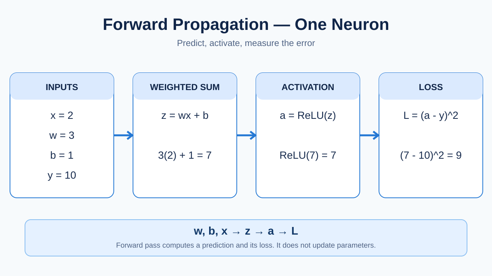
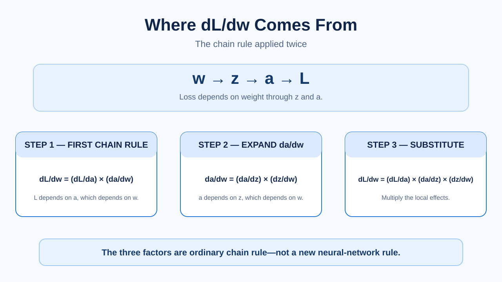
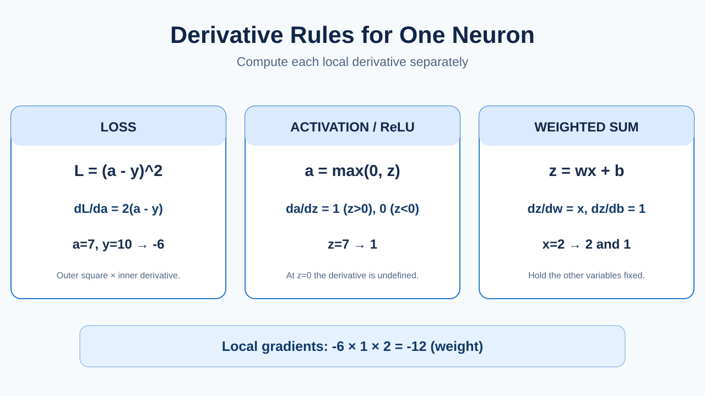
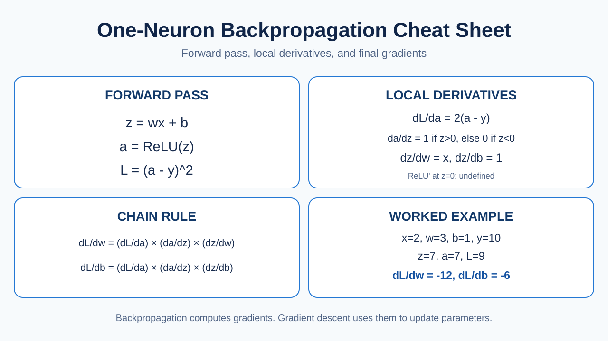

# 09 — Chain Rule: From Forward Pass to Weight and Bias Gradients

**Checkpoint: 17 October 2026.** One-neuron derivative calculations and the *reason* behind the multi-factor chain rule were practiced. This is **not** yet an implementation of multi-layer backpropagation or a trained XOR network.

## Learning objective

Derive (do not memorize) why:

\`\`\`math
\frac{\partial L}{\partial w} =
\frac{\partial L}{\partial a}
\cdot \frac{\partial a}{\partial z}
\cdot \frac{\partial z}{\partial w}
\`\`\`

The only new idea is to apply the familiar chain rule **twice**.

## 1. Forward propagation

For a single neuron:

\`\`\`math
z=wx+b,\qquad a=\operatorname{ReLU}(z),\qquad L=(a-y)^2
\`\`\`

| Symbol | Meaning |
| --- | --- |
| \(x\) | Input, held fixed when differentiating parameters |
| \(w\) | Trainable weight |
| \(b\) | Trainable bias |
| \(z\) | Weighted sum / pre-activation |
| \(a\) | Activation / model prediction |
| \(y\) | Known target |
| \(L\) | Squared-error loss |

For \(x=2\), \(w=3\), \(b=1\), and \(y=10\):

\`\`\`math
z=3(2)+1=7,\qquad a=\operatorname{ReLU}(7)=7
\`\`\`

\`\`\`math
L=(7-10)^2=9
\`\`\`

**Forward propagation calculates a prediction and its loss.** It does not update parameters.

## 2. What derivative notation means

Read \(\partial L/\partial w\) as: **How does the loss change if the weight changes slightly while the other independent quantities are held fixed?**

- Numerator: the quantity whose change we measure.
- Denominator: the variable we change.
- The symbol \(\partial\) denotes a **partial derivative**, useful when a function depends on several variables.

A negative gradient means a small increase in the variable tends to **decrease** loss, locally. It is not an instruction to always increase that variable; the sign can change at a different point.

## 3. Start with the chain rule you already know

For:

\`\`\`math
L=(3w+2)^2
\`\`\`

Differentiate the outer square and then the inner expression:

\`\`\`math
\frac{dL}{dw}=2(3w+2)\cdot\underbrace{3}_{d(3w+2)/dw}=6(3w+2)
\`\`\`

The neuron has the *same structure*, except there are two intermediate quantities.

The dependency path is:

\`w -> z -> a -> L\`

Start with the desired derivative:

\`\`\`math
\frac{\partial L}{\partial w}
\`\`\`

Because \(L\) depends on \(a\), apply the chain rule **once**:

\`\`\`math
\frac{\partial L}{\partial w}
=\frac{\partial L}{\partial a}\cdot\frac{\partial a}{\partial w}
\`\`\`

But \(a\) depends on \(z\), which depends on \(w\). Apply it **again**:

\`\`\`math
\frac{\partial a}{\partial w}
=\frac{\partial a}{\partial z}\cdot\frac{\partial z}{\partial w}
\`\`\`

Substitute the second equation into the first:

\`\`\`math
\boxed{
\frac{\partial L}{\partial w}
=\frac{\partial L}{\partial a}
\cdot\frac{\partial a}{\partial z}
\cdot\frac{\partial z}{\partial w}
}
\`\`\`

Nothing new was invented for neural networks: this is ordinary differentiation through nested functions. For a bias gradient, replace the final factor with \(\partial z/\partial b\).

## 4. Actually differentiate each part

### 4.1 Loss with respect to activation

\`\`\`math
L=(a-y)^2
\`\`\`

Differentiate the **outer square**, then the **inner** \(a-y\):

\`\`\`math
\frac{\partial L}{\partial a}
=2(a-y)\cdot\frac{\partial}{\partial a}(a-y)
=2(a-y)(1-0)=2(a-y)
\`\`\`

Given \(a=7\) and \(y=10\), this equals \(2(7-10)=\boxed{-6}\).

### 4.2 Activation with respect to pre-activation

\`\`\`math
a=\operatorname{ReLU}(z)=
\begin{cases}
z & z>0\\
0 & z\leq0
\end{cases}
\`\`\`

For positive \(z\), \(da/dz=d(z)/dz=1\).
For negative \(z\), \(da/dz=d(0)/dz=0\).

\`\`\`math
\frac{\partial a}{\partial z}
=\begin{cases}1 & z>0\\0 & z<0\end{cases}
\`\`\`

At \(z=0\), ReLU is mathematically not differentiable; many implementations choose a derivative of 0 by convention. At \(z=7\), \(\partial a/\partial z=\boxed{1}\).

### 4.3 Weighted sum with respect to weight

\`\`\`math
z=wx+b
\`\`\`

Treat \(x\) and \(b\) as constants:

\`\`\`math
\frac{\partial z}{\partial w}
=\frac{\partial}{\partial w}(wx+b)
=x\frac{\partial w}{\partial w}
+\frac{\partial b}{\partial w}
=x(1)+0=\boxed{x=2}
\`\`\`

### 4.4 Weighted sum with respect to bias

Treat \(w\) and \(x\) as constants:

\`\`\`math
\frac{\partial z}{\partial b}
=\frac{\partial}{\partial b}(wx+b)
=0+\frac{\partial b}{\partial b}
=\boxed{1}
\`\`\`

## 5. Multiply the local derivatives

For the weight:

\`\`\`math
\frac{\partial L}{\partial w}=(-6)(1)(2)=\boxed{-12}
\`\`\`

For the bias:

\`\`\`math
\frac{\partial L}{\partial b}
=\frac{\partial L}{\partial a}\frac{\partial a}{\partial z}\frac{\partial z}{\partial b}
=(-6)(1)(1)=\boxed{-6}
\`\`\`

**Check using direct differentiation:** Because \(z=7>0\), the ReLU is locally the identity. Therefore:

\`\`\`math
L=(wx+b-y)^2
\`\`\`

\`\`\`math
\frac{\partial L}{\partial w}=2(wx+b-y)x
=2(6+1-10)(2)=-12
\`\`\`

Both approaches agree. The multi-factor approach scales to deeper networks.

## 6. Quick reference

| Question | Derivative | Value in our example |
| --- | --- | ---: |
| How does loss react to \(a\)? | \(\partial L/\partial a=2(a-y)\) | -6 |
| How does \(a\) react to \(z\)? | \(\partial a/\partial z=\mathrm{ReLU}'(z)\) | 1 |
| How does \(z\) react to \(w\)? | \(\partial z/\partial w=x\) | 2 |
| How does \(z\) react to \(b\)? | \(\partial z/\partial b=1\) | 1 |
| Final weight gradient | \(\partial L/\partial w\) | -12 |
| Final bias gradient | \(\partial L/\partial b\) | -6 |

**What's next:** turn these gradients into a parameter update, then generalize to matrices and the planned \(2\to3\to1\) XOR network. **Do not mark the full network or hidden-layer backprop as complete yet.**
