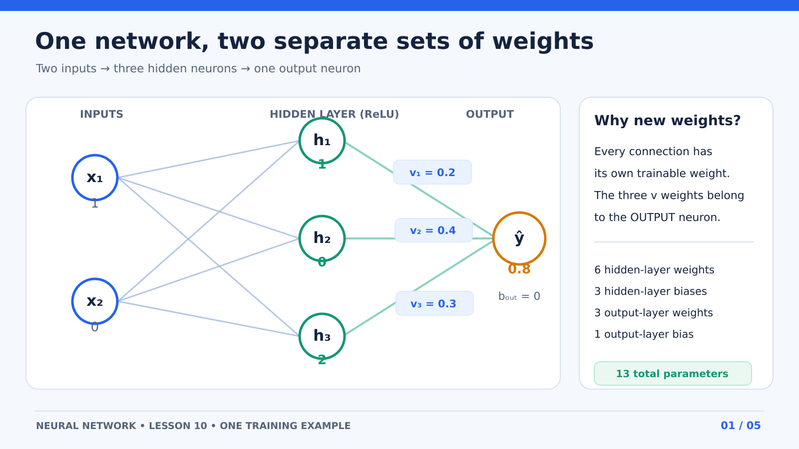
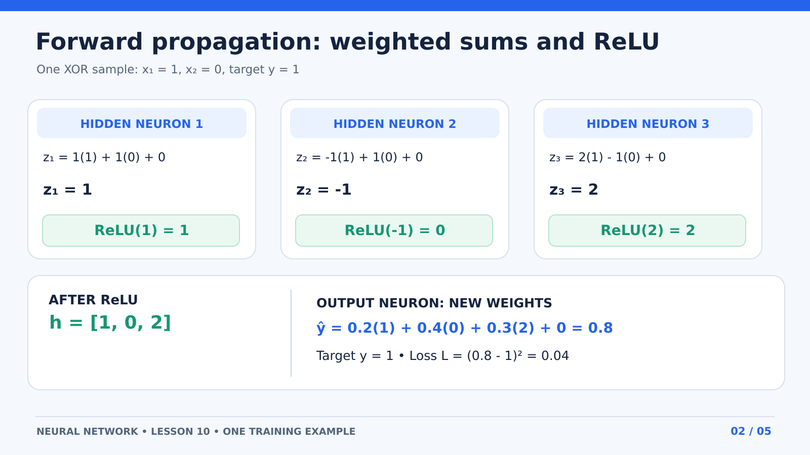
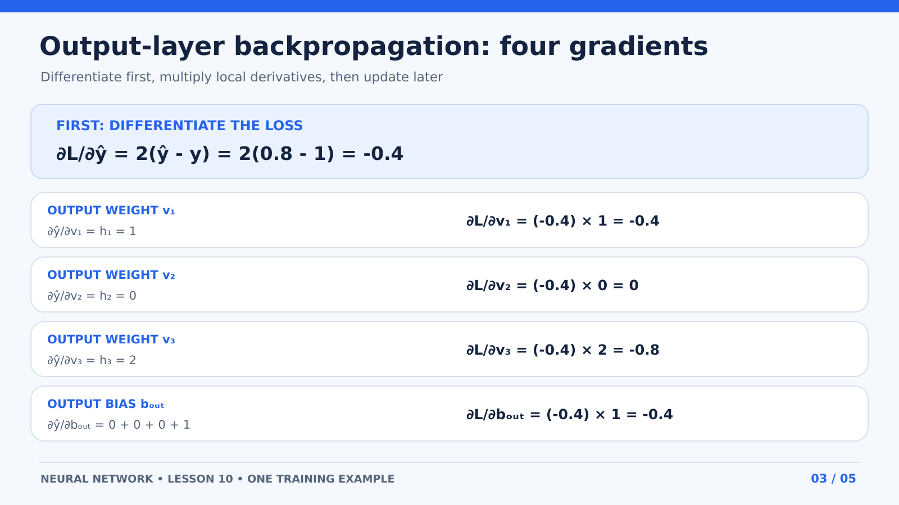
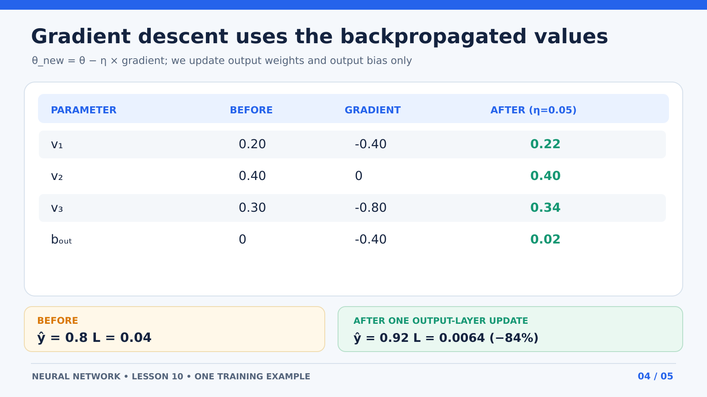
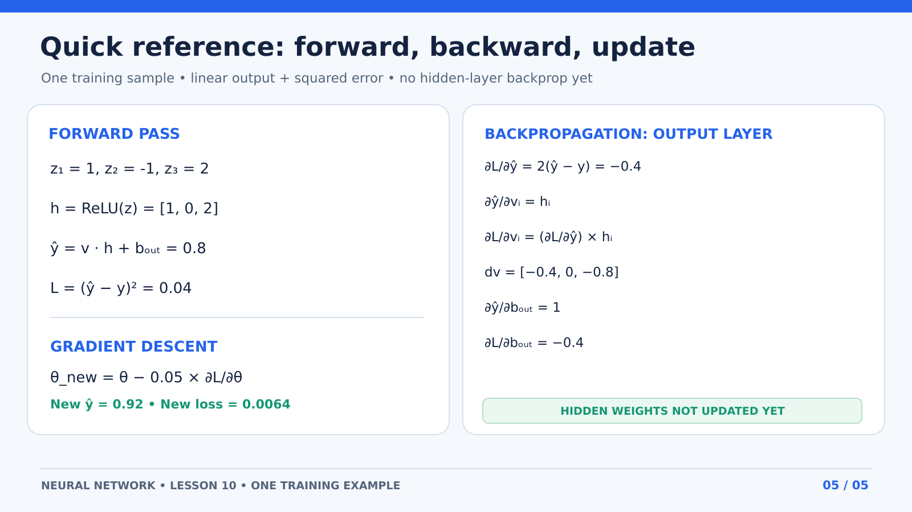

# 10 — Forward Pass and Output-Layer Backpropagation (17 October 2026)

**Status:** Worked through a **2 → 3 → 1** network by hand. Calculated the output-layer weight and bias gradients, then performed one output-layer gradient-descent update. **Hidden-layer backpropagation and complete XOR training are not done yet.**

**Prerequisite:** [Lesson 09 — Chain Rule and One-Neuron Gradients](09-chain-rule-and-backpropagation-gradients.md).

## 1. Why are there new weights?

A neural network has **a separate weight for each connection**. Each neuron has a bias too.

Our architecture:

- **2 inputs:** $x_1,x_2$
- **3 hidden neurons:** $h_1,h_2,h_3$, each receives both inputs
- **1 output neuron:** receives $h_1,h_2,h_3$

The hidden layer therefore has $2 \times 3=6$ weights and $3$ biases. The output layer has $3$ **new** weights and $1$ bias: **13 trainable parameters total**.

The numerical weights in this lesson were **assigned manually to explain the computation**. A real training run initializes parameters, typically with a suitable random method, and updates them from gradients. We never copy the hidden-layer weights into the output layer.



## 2. The hidden-layer forward pass

For **one** neuron with **one** input:

```math
z = wx+b
```

For one neuron with **two** inputs, each input has its own weight:

```math
z = w_1 x_1+w_2 x_2+b
```

The **same two inputs** enter all three hidden neurons. Each hidden neuron uses **different weights**.

For this example, input $x_1=1,\;x_2=0$, and all hidden biases are zero:

```math
\begin{aligned}
z_1 &= 1x_1+1x_2+0 = 1(1)+1(0)=1\\
z_2 &= -1x_1+1x_2+0 = -1(1)+1(0)=-1\\
z_3 &= 2x_1-1x_2+0 = 2(1)-1(0)=2
\end{aligned}
```

Then apply **ReLU separately to each** weighted sum:

```math
h_i=\operatorname{ReLU}(z_i)=\max(0,z_i)
```

```math
h_1=1,\quad h_2=0,\quad h_3=2
```

The output of the hidden layer is therefore $\mathbf{h}=[1,0,2]$. **$z$ is before ReLU; $h$ is after ReLU.**



## 3. Output neuron: more weights, same weighted sum

The three hidden activations are now **inputs to the output neuron**.

This neuron's **own** weights are:

```math
v_1=0.2,\quad v_2=0.4,\quad v_3=0.3,\quad b_{\mathrm{out}}=0
```

Use $v$ for the output weights so they cannot be confused with hidden-layer weights.

```math
z_{\mathrm{out}}=v_1h_1+v_2h_2+v_3h_3+b_{\mathrm{out}}
```

```math
=0.2(1)+0.4(0)+0.3(2)+0=\boxed{0.8}
```

**For this teaching example only**, the output activation is linear, so $\hat y=z_{\mathrm{out}}=0.8$. For the target $y=1$, use a single-example squared-error loss:

```math
L=(\hat y-y)^2=(0.8-1)^2=\boxed{0.04}
```

**Note:** This is one forward pass for one example, not a trained XOR classifier. Our XOR project will train over all four input pairs.

## 4. Output backpropagation: compute gradients before changing anything

We want to determine how the loss responds to **each output parameter**. First calculate the loss derivative:

```math
\begin{aligned}
\frac{\partial L}{\partial\hat y}
&=\frac{\partial}{\partial\hat y}(\hat y-y)^2\\
&=2(\hat y-y)\cdot\frac{\partial}{\partial\hat y}(\hat y-y)\\
&=2(\hat y-y)\cdot(1-0)\\
&=2(0.8-1)=\boxed{-0.4}
\end{aligned}
```

For every output weight, the dependence is **weight $\rightarrow\hat y\rightarrow L$**.

Therefore the **same chain rule** applies:

```math
\frac{\partial L}{\partial v_i}
=\frac{\partial L}{\partial\hat y}
\cdot
\frac{\partial\hat y}{\partial v_i}
```

### 4.1 Derivative with respect to $v_1$

Differentiate the prediction **term by term**, treating other independent parameters and hidden outputs as constants:

```math
\begin{aligned}
\frac{\partial\hat y}{\partial v_1}
&=\frac{\partial}{\partial v_1}(v_1h_1+v_2h_2+v_3h_3+b_{\mathrm{out}})\\
&=h_1(1)+0+0+0=\boxed{h_1=1}
\end{aligned}
```

Multiply the two derivatives:

```math
\frac{\partial L}{\partial v_1}=(-0.4)(1)=\boxed{-0.4}
```

### 4.2 Derivative with respect to $v_2$

```math
\frac{\partial\hat y}{\partial v_2}=0+h_2+0+0=h_2=0
```

```math
\frac{\partial L}{\partial v_2}=(-0.4)(0)=\boxed{0}
```

Because $h_2=0$, changing $v_2$ has no effect on this example's prediction. **That does not mean $v_2$ will never learn on other inputs.**

### 4.3 Derivative with respect to $v_3$

```math
\frac{\partial\hat y}{\partial v_3}=0+0+h_3+0=h_3=2
```

```math
\frac{\partial L}{\partial v_3}=(-0.4)(2)=\boxed{-0.8}
```

### 4.4 Derivative with respect to the output bias — complete derivation

**Do not skip the differentiation of the bias.**

```math
\begin{aligned}
\frac{\partial\hat y}{\partial b_{\mathrm{out}}}
&=\frac{\partial}{\partial b_{\mathrm{out}}}
(v_1h_1+v_2h_2+v_3h_3+b_{\mathrm{out}})\\
&=0+0+0+1\\
&=\boxed{1}
\end{aligned}
```

The loss depends on the bias through the prediction, so use the chain rule **again**:

```math
\begin{aligned}
\frac{\partial L}{\partial b_{\mathrm{out}}}
&=\frac{\partial L}{\partial\hat y}
\cdot\frac{\partial\hat y}{\partial b_{\mathrm{out}}}\\
&=(-0.4)(1)=\boxed{-0.4}
\end{aligned}
```

The derivative is not multiplied by $h_1,h_2,h_3$ or $x$ because **the derivative of the additive bias term with respect to itself is $1$**.



### 4.5 Gradient summary

| Parameter | Value before update | Gradient |
|---|---:|---:|
| $v_1$ | 0.20 | -0.40 |
| $v_2$ | 0.40 | 0.00 |
| $v_3$ | 0.30 | -0.80 |
| $b_{\mathrm{out}}$ | 0.00 | -0.40 |

**Backpropagation only calculates these gradients. It does not update the weights or bias.**

## 5. Gradient descent: use the gradients to update the parameters

Learning rate: $\eta=0.05$.

For any output parameter $\theta$:

```math
\theta_{\mathrm{new}}
=\theta-\eta\frac{\partial L}{\partial\theta}
```

Calculate all gradients from the **same original forward pass**, then update the parameters:

```math
\begin{aligned}
v_{1,\mathrm{new}}&=0.2-0.05(-0.4)=0.22\\
v_{2,\mathrm{new}}&=0.4-0.05(0)=0.40\\
v_{3,\mathrm{new}}&=0.3-0.05(-0.8)=0.34\\
b_{\mathrm{out,new}}&=0-0.05(-0.4)=0.02
\end{aligned}
```

The **hidden-layer parameters remain unchanged** in this demonstration.

## 6. Run another forward pass and check the loss

With the same hidden outputs $[1,0,2]$:

```math
\begin{aligned}
\hat y_{\mathrm{new}}
&=0.22(1)+0.40(0)+0.34(2)+0.02\\
&=\boxed{0.92}
\end{aligned}
```

```math
L_{\mathrm{new}}=(0.92-1)^2=\boxed{0.0064}
```

Loss changed from $0.04$ to $0.0064$, an **84% reduction on this one example after one output-layer update**. That is **not** a claim about XOR accuracy or future updates.



## 7. Equivalent minimal NumPy code

A runnable version is in [examples/output_layer_single_step.py](../examples/output_layer_single_step.py).

```python
import numpy as np

x = np.array([1.0, 0.0])
W_hidden = np.array([[1., 1.], [-1., 1.], [2., -1.]])
b_hidden = np.zeros(3)
v = np.array([0.2, 0.4, 0.3])
b_out = 0.0
y = 1.0
lr = 0.05

z_hidden = W_hidden @ x + b_hidden
h = np.maximum(0, z_hidden)
pred = v @ h + b_out
loss = (pred - y) ** 2

dL_dpred = 2 * (pred - y)
dv = dL_dpred * h
db_out = dL_dpred * 1.0

v = v - lr * dv
b_out = b_out - lr * db_out

new_pred = v @ h + b_out
new_loss = (new_pred - y) ** 2
assert np.allclose(h, [1, 0, 2])
assert np.allclose(dv, [-0.4, 0, -0.8])
assert np.isclose(db_out, -0.4)
assert np.allclose(v, [0.22, 0.4, 0.34])
assert np.isclose(b_out, 0.02)
assert np.isclose(new_pred, 0.92)
assert np.isclose(new_loss, 0.0064)
```

## 8. What is completed, and what is next?

**Completed in this lesson:** network wiring, hidden ReLU forward pass, output linear prediction, squared loss, individual output-weight gradients, **fully differentiated output bias**, and an output-layer parameter update.

**Not completed:** backpropagation into the **hidden neurons** and training on the **complete XOR dataset**.

**Next lesson:** backpropagate the output error through $h_1,h_2,h_3$, differentiate ReLU and each hidden-layer weight, then combine all gradients in one update.


