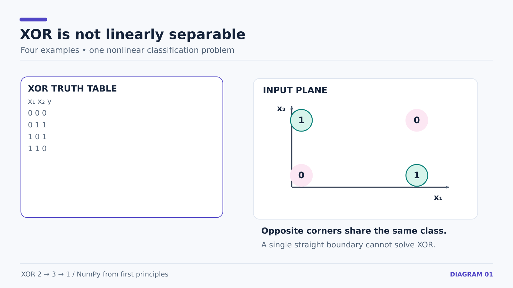

# 11 — XOR: Problem, Dataset, and the 2 → 3 → 1 Architecture

**Checkpoint:** 18 October 2026. Earlier notes cover single-neuron calculus and an illustrative output-layer update. Here we begin the complete XOR network.

## Goal: learn a nonlinear truth table

| Input x1 | Input x2 | XOR target y |
| ---: | ---: | ---: |
| 0 | 0 | 0 |
| 0 | 1 | 1 |
| 1 | 0 | 1 |
| 1 | 1 | 0 |

XOR is 1 only when the two inputs differ. A single affine transformation followed by one threshold cannot separate these four points with a straight decision boundary. A hidden layer with a nonlinear activation can represent the needed pattern.



### Our architecture

- **2 input features**, x1 and x2
- **3 hidden units** with ReLU: h1, h2, h3
- **1 output unit** with sigmoid, producing a probability-like value between 0 and 1


### Trainable parameters

| Parameter | Shape | Number | Purpose |
| --- | --- | ---: | --- |
| W_h | (2, 3) | 6 | Input → hidden connections |
| b_h | (3,) | 3 | One bias per hidden unit |
| W_o | (3, 1) | 3 | Hidden → output connections |
| b_o | (1,) | 1 | Output bias |
| **Total** | | **13** | All updated by gradient descent |

Each connection has its own weight. Initial values are not the final learned values.

### Dataset code

```python
X = np.array([[0., 0.],
              [0., 1.],
              [1., 0.],
              [1., 1.]])
y = np.array([[0.], [1.], [1.], [0.]])
```

- `X.shape == (4, 2)`: four samples, two input features each.
- `y.shape == (4, 1)`: one label for each sample.
- The same parameters are shared across all four examples during training.

**Distinction:** “2 → 3 → 1” describes architecture. “4 examples” describes batch size. These are independent quantities.

**Next:** [12 — Vectorized forward pass](12-xor-vectorized-forward-and-loss.md).