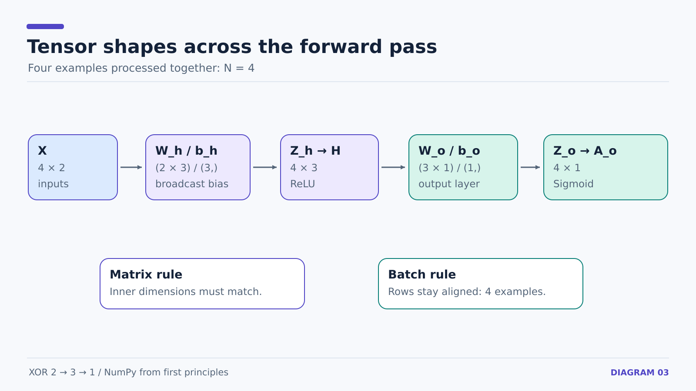
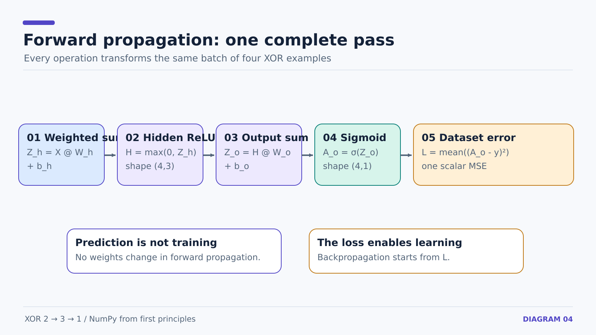

# 12 — Vectorized XOR Forward Propagation and MSE

**Prerequisites:** [11 — architecture](11-xor-problem-and-architecture.md) and [04 — hidden-layer forward pass](04-hidden-layer-forward-pass.md).

## Variable definitions

- `X`: inputs, shape (N, 2), with N = 4.
- `W_h`: six hidden weights, shape (2, 3); `b_h`: three hidden biases, shape (3,).
- `z_h`: pre-activation values of three hidden units, shape (N, 3).
- `h`: ReLU activation after the hidden weighted sum, shape (N, 3).
- `W_o`: three output weights, shape (3, 1); `b_o`: one output bias.
- `z_o`: output pre-activation, shape (N, 1).
- `a_o`: sigmoid output, shape (N, 1).
- `y`: targets, shape (N, 1); `L`: single scalar mean squared error.



## Forward equations, one operation at a time

**1. Hidden weighted sum**

```math
Z_h=XW_h+b_h
```

Each row of `X` is multiplied by the six weights; NumPy broadcasts `b_h` across the four rows.

```python
z_h = X @ W_h + b_h
```

**2. Hidden activation — ReLU**

```math
H_{ij}=\max(0,(Z_h)_{ij})
```

```python
h = np.maximum(0, z_h)
```

ReLU provides a nonlinear transformation. Zero or negative pre-activations are mapped to zero.

**3. Output weighted sum**

```math
Z_o=HW_o+b_o
```

```python
z_o = h @ W_o + b_o
```

Here matrix multiplication is `(4,3) @ (3,1) → (4,1)`.

**4. Output activation — sigmoid**

```math
A_o=\sigma(Z_o)=\frac{1}{1+e^{-Z_o}}
```

```python
a_o = 1 / (1 + np.exp(-z_o))
```



## Error and loss

```math
L=\frac{1}{N}\sum_{i=1}^{N}(a_o^{(i)}-y^{(i)})^2
```

```python
error = a_o - y
squared_error = error ** 2
loss = np.mean(squared_error)
```

**Important:** Square **before** taking the mean. The scalar loss reports the error for the whole batch, not for one row only.

At this stage, the network has made predictions but **has not learned yet**. Training begins once gradients change the weights and biases.

**Next:** [13 — output-layer backpropagation](13-xor-output-layer-backprop.md).