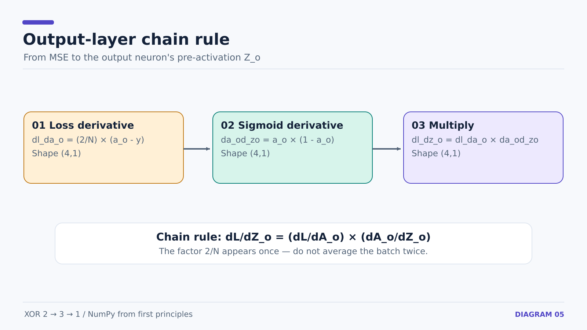
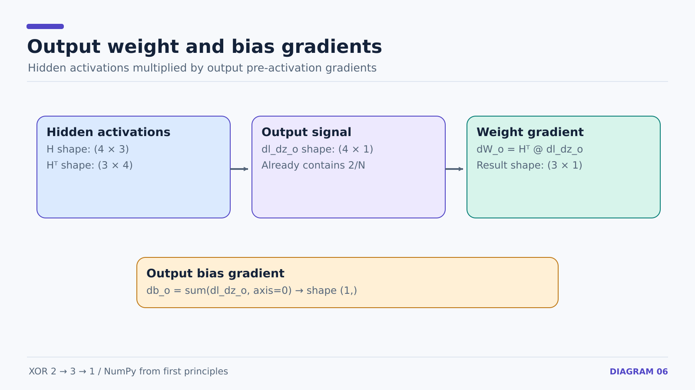

# 13 — Backpropagation Through the Output Layer

**Prerequisite:** [12 — forward propagation and loss](12-xor-vectorized-forward-and-loss.md).

We derive gradients from the output toward the hidden layer. No parameter is updated until **all** gradients have been calculated.

## Forward values available from the previous step

```math
Z_o=HW_o+b_o,\qquad A_o=\sigma(Z_o),\qquad
L=\frac1N\sum_{i=1}^N(a_o^{(i)}-y^{(i)})^2
```

`N=4` is the number of XOR examples. `H` is the ReLU hidden activation matrix. `W_o` and `b_o` belong only to the output neuron.

## Step 1: loss with respect to output activation

For one sample, `(a_o-y)^2` has derivative `2(a_o-y)` with respect to `a_o`. Mean squared error divides by the number of samples:

```math
\frac{\partial L}{\partial A_o}=\frac{2}{N}(A_o-y).
```

```python
dl_da_o = 2 / len(X) * (a_o - y)
```

Shape: `(4,1)`.

## Step 2: output activation with respect to pre-activation

Sigmoid's local derivative is:

```math
\frac{\partial A_o}{\partial Z_o}=A_o\odot(1-A_o)
```

```python
da_od_zo = a_o * (1 - a_o)
```

The `* ` operation is elementwise multiplication here.

## Step 3: apply the chain rule

```math
\frac{\partial L}{\partial Z_o}=
\frac{\partial L}{\partial A_o}\odot
\frac{\partial A_o}{\partial Z_o}
```

```python
dl_dz_o = dl_da_o * da_od_zo
```



## Step 4: output weights and bias

The output pre-activation is `Z_o = H @ W_o + b_o`. For output weight `W_o[j,0]`, its local derivative in sample `i` is the matching hidden activation `H[i,j]`. Sum over samples:

```math
\frac{\partial L}{\partial W_o} = H^T\frac{\partial L}{\partial Z_o}
```

```python
dW_o = h.T @ dl_dz_o      # (3,4) @ (4,1) -> (3,1)
db_o = np.sum(dl_dz_o, axis=0)  # (1,)
```

The bias derivative is 1 for each sample, so its gradient is the sum of the already-normalized `dl_dz_o` entries.



**Do not divide by N a second time.** The factor `2/N` was already applied in `dl_da_o`.

**Do not use** `dW_o.T` to send gradients back through the layer. Backprop uses the **current weight matrix** `W_o.T`, not its gradient.

**Next:** [14 — hidden-layer backpropagation](14-xor-hidden-layer-backprop.md).