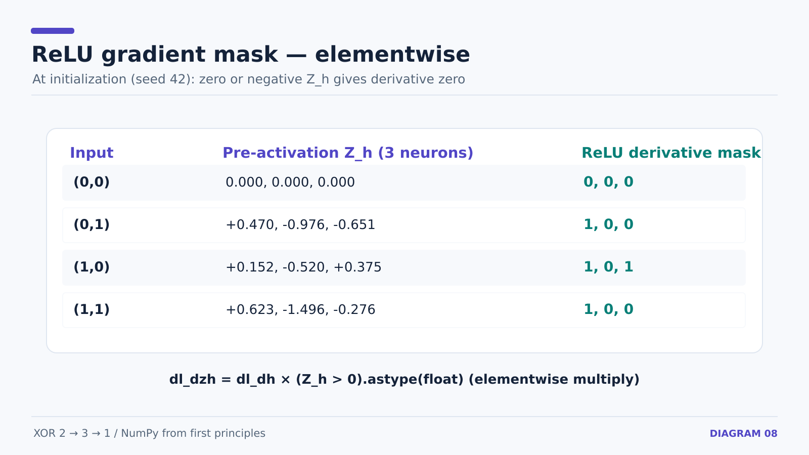

# 14 — Backpropagation Through the Hidden ReLU Layer

**Prerequisite:** [13 — output gradients](13-xor-output-layer-backprop.md). This lesson fills the gap beyond our earlier *output-only* worked example in lesson 10.

## What we already know

Forward pass:

```math
Z_h=XW_h+b_h,\quad H=\mathrm{ReLU}(Z_h),\quad
Z_o=HW_o+b_o,\quad A_o=\sigma(Z_o)
```

Loss: `L = mean((A_o - y)**2)`.

Previously computed: `dl_dz_o`, shape `(4,1)`. The remaining goal is to find the six hidden weight gradients and three hidden bias gradients.


## Step 1 — Move from output pre-activation back to hidden activations

Each output pre-activation is:

```math
z_o^{(i)}=h_1^{(i)}v_1+h_2^{(i)}v_2+h_3^{(i)}v_3+b_o
```

Here `v_j = W_o[j,0]`. Holding other activations fixed, `\partial z_o / \partial h_j = v_j`. By the chain rule:

```math
\frac{\partial L}{\partial h_j^{(i)}}=
\frac{\partial L}{\partial z_o^{(i)}}\,v_j.
```

For all four samples and all three hidden neurons at once:

```python
dl_dh = dl_dz_o @ W_o.T  # (4,1) @ (1,3) -> (4,3)
```

The values flow backward using **weights** `W_o`; `dW_o` stores how to update the weights, not how hidden activations influenced the output.

## Step 2 — Pass through ReLU

We know `h = ReLU(z_h)`. Its derivative is 1 where the pre-activation is positive; otherwise, the implementation uses 0 (including at exactly zero).

```math
\mathrm{ReLU}'(z)=\begin{cases}1,&z>0\\0,&z\leq0\end{cases}
```

```python
dh_dhz = (z_h > 0).astype(float)
dl_dzh = dl_dh * dh_dhz
```

Each array has shape `(4,3)`. This multiplication is **elementwise**, not matrix multiplication.



## Step 3 — Hidden weight gradients

For input feature `x_k` to hidden neuron `j`:

```math
z_{h,j}^{(i)}=\sum_{k=1}^{2}x_k^{(i)}W_{h,kj}+b_{h,j}
```

Thus the local derivative with respect to `W_h[k,j]` is `x_k^{(i)}`. Sum the resulting gradient over the four examples:

```math
\frac{\partial L}{\partial W_h}=X^T\frac{\partial L}{\partial Z_h}
```

```python
dW_h = X.T @ dl_dzh  # (2,4) @ (4,3) -> (2,3)
```

The result matches the six hidden weights.

## Step 4 — Hidden bias gradients

Each hidden bias enters its corresponding `z_h` with derivative 1:

```math
\frac{\partial L}{\partial b_{h,j}}=
\sum_{i=1}^{N}\frac{\partial L}{\partial z_{h,j}^{(i)}}
```

```python
db_h = np.sum(dl_dzh, axis=0)  # (3,)
```

Summing `axis=0` combines **examples**, leaving one gradient per hidden neuron.

### Final shape check

`dW_h(2,3)`, `db_h(3,)`, `dW_o(3,1)`, `db_o(1,)`: **13 scalar parameter gradients** in total.

**Next:** [15 — the gradient descent training loop](15-xor-gradient-descent-and-epochs.md).