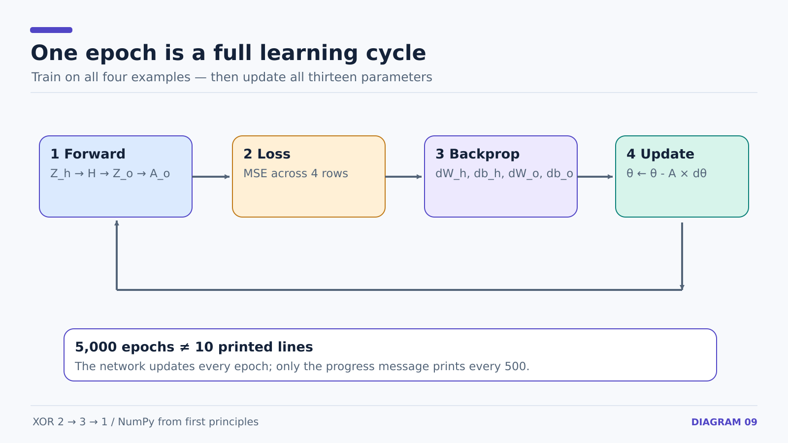

# 15 — From One Gradient Descent Update to 5,000 Training Epochs

**Prerequisite:** [14 — full hidden-layer gradients](14-xor-hidden-layer-backprop.md).

Once gradients are computed from a forward pass using the **current** weights, all trainable parameters can be updated.

## One update: the same rule for all parameters

```math
\theta_{\rm new}=\theta_{\rm old}-\alpha\frac{\partial L}{\partial\theta}
```

`\alpha` is the learning rate, `0.05` in our script (stored in variable `A`).

```python
W_h = W_h - A * dW_h
b_h = b_h - A * db_h

W_o = W_o - A * dW_o
b_o = b_o - A * db_o
```

The gradients **must all be calculated before the first weight update**. Backpropagation uses the original `W_o` to calculate `dl_dh`, so updating `W_o` too early would use mixed parameter states.



## Why recalculate the forward pass after updating?

The variables `z_h`, `h`, `z_o`, `a_o`, and `loss` were computed using the **previous** parameter values. Python does not automatically recompute them when a weight changes.

To evaluate updated weights, do a new forward pass:

```python
z_h_new = X @ W_h + b_h
h_new = np.maximum(0, z_h_new)
z_o_new = h_new @ W_o + b_o
a_o_new = 1 / (1 + np.exp(-z_o_new))
new_loss = np.mean((a_o_new - y) ** 2)
```

In our first manually assigned weight experiment, the single update decreased MSE from approximately `0.255755` to `0.255660`.

## An epoch is not the print interval

**One epoch** uses all four XOR examples to calculate a full-batch gradient and make **one** parameter update.

```python
epochs = 5000

for epoch in range(epochs):
    # forward pass
    # MSE loss
    # all gradients
    # all parameter updates

    if epoch % 500 == 0:
        print(f"Epoch {epoch} | Loss: {loss:.6f}")
```

- `for epoch in range(epochs):` trains 5,000 times: epochs 0 through 4,999.
- `if epoch % 500 == 0:` prints only every 500th epoch.
- Placing the **entire training block inside that if** would train only on matching indices, which is wrong.
- Initialization must stay **outside** the loop; otherwise every epoch restarts from the same initial parameters.

The complete training loop is in [examples/xor_network.py](../examples/xor_network.py). Each gradient is calculated explicitly using NumPy.

**Next:** [16 — random initialization and XOR evaluation](16-xor-random-initialization-and-results.md).