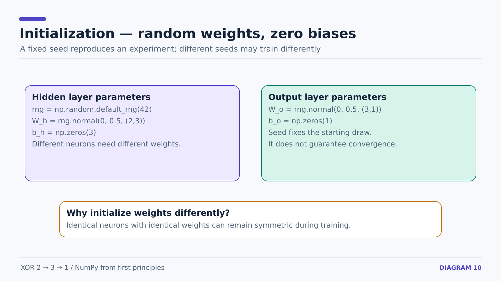
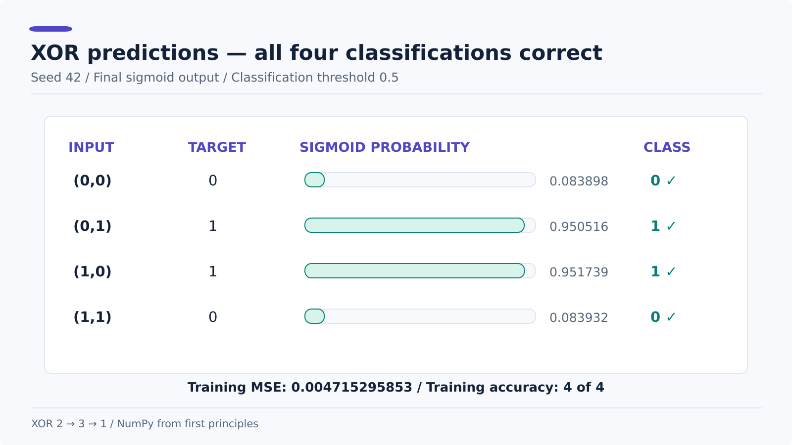

# 16 — Reproducible Random Initialization and Evaluating XOR

**Prerequisite:** [15 — epoch training](15-xor-gradient-descent-and-epochs.md).

Our first full XOR network used manually chosen weights to make every calculation easier to follow. We then switched to random initialization without changing the mathematics of forward propagation, backpropagation, or gradient descent.

## Random weights; zero biases

```python
rng = np.random.default_rng(42)

W_h = rng.normal(0, 0.5, size=(2, 3))
b_h = np.zeros(3)

W_o = rng.normal(0, 0.5, size=(3, 1))
b_o = np.zeros(1)
```

- `np.random.default_rng(42)` creates a reproducible random generator.
- `rng.normal(0, 0.5, size=...)` draws weights with mean 0 and standard deviation 0.5.
- Biases initialize to zero; randomly different **hidden weights** break symmetry between hidden units.
- The number 42 is a reproducibility seed, not a learning-rate setting or magic value that guarantees success.



### Pitfalls caught during implementation

- `np.random.default.rng(42)` is invalid; the method name is **`default_rng`**.
- `np.normal(1)` is invalid; output bias should use `np.zeros(1)` here.
- All equal weights can make neurons learn identical patterns, so different initial weights matter.
- With just three ReLU units, some random seeds can train poorly or leave neurons inactive; seed 42 works for this experiment but is not guaranteed to be representative.

## Full 5,000-epoch loss trace (seed 42)

The loss below is calculated **at the beginning** of the listed epoch, before that epoch's gradient update.

| Epoch | Training MSE |
| ---: | ---: |
| 0 | 0.25023636 |
| 500 | 0.22134667 |
| 1000 | 0.18205232 |
| 1500 | 0.16114958 |
| 2000 | 0.08436386 |
| 2500 | 0.02993619 |
| 3000 | 0.01605965 |
| 3500 | 0.01045661 |
| 4000 | 0.00756720 |
| 4500 | 0.00584314 |


## Final predictions — after the last update

```python
predictions = (a_o_new >= 0.5).astype(int)
```

| x1 | x2 | Target | Final sigmoid output | Predicted class |
| ---: | ---: | ---: | ---: | ---: |
| 0 | 0 | 0 | 0.08389788 | 0 |
| 0 | 1 | 1 | 0.95051648 | 1 |
| 1 | 0 | 1 | 0.95173893 | 1 |
| 1 | 1 | 0 | 0.08393200 | 0 |



**Final training MSE:** `0.00471529585312808`.

**Correct classifications:** 4 of 4 = 100% on the complete XOR training set.

This is a small educational fit to four known examples, **not** an independent test of generalization. All four rows used for evaluation are the same rows used in training.

## What this run verifies

The seeded run reproduces the listed predictions and training MSE. The four evaluated examples are the training set, so this is not a test of generalization.

The analytical gradients have not yet been compared against finite-difference estimates for all 13 parameters.

**Code:** [examples/xor_network.py](../examples/xor_network.py) · **Diagrams:** [assets/xor](../assets/xor).